# Trọn bộ 6 Biểu đồ Hoạt động (Activity Diagrams) — Hệ thống Học tiếng Anh Đa nền tảng

Tài liệu này cung cấp toàn bộ **6 Biểu đồ Hoạt động (Activity Diagrams)** cốt lõi của hệ thống, chuẩn hóa theo ký hiệu UML tiêu chuẩn có phân chia làn đường trách nhiệm (**Swimlanes**):
1. **Học viên** (Người dùng cuối)
2. **Giao diện Client** (Web React / Mobile App)
3. **Hệ thống Backend** (Node.js / Express REST API)
4. **Cơ sở dữ liệu & Cache** (PostgreSQL / Redis)

---

## Hướng dẫn Import vào Draw.io
Bạn có thể đưa biểu đồ vào Draw.io chỉ với 3 bước:
1. Mở [draw.io](https://app.diagrams.net/).
2. Trên thanh menu, chọn **`+` (Insert)** hoặc **`Arrange`** $\rightarrow$ **`Advanced`** $\rightarrow$ chọn **`PlantUML`** (Khuyên dùng) hoặc **`Mermaid`**.
3. Dán đoạn mã tương ứng bên dưới vào và bấm **`Insert`**.

---

## 1. Biểu đồ 1: Xác thực & Đăng nhập hệ thống (Authentication)

Mô tả quy trình đăng nhập, mã hóa bcrypt, xác thực session qua Redis và cấp phát JWT token có hỗ trợ cookie HttpOnly.

### 1.1. Mã PlantUML
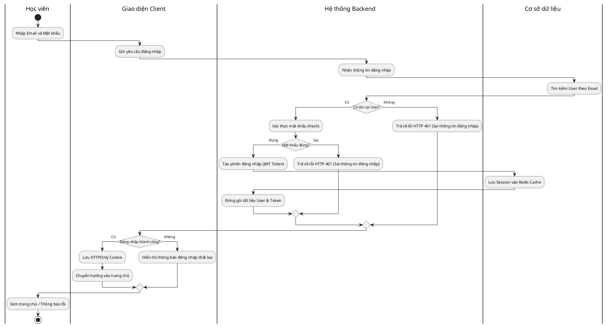

### 1.2. Mã Mermaid
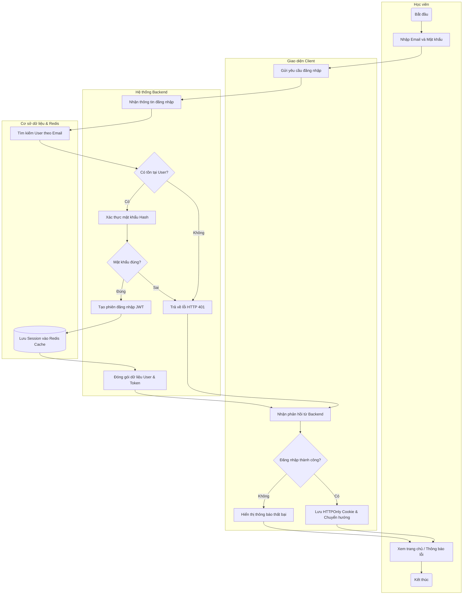

---

## 2. Biểu đồ 2: Tra cứu từ điển Lai (Multi-tier Dictionary Search)

Mô tả cơ chế tối ưu hiệu năng tra cứu qua 3 tầng: CSDL PostgreSQL nội bộ $\rightarrow$ Bộ nhớ đệm Redis $\rightarrow$ Dịch vụ dịch thuật bên ngoài.

### 2.1. Mã PlantUML
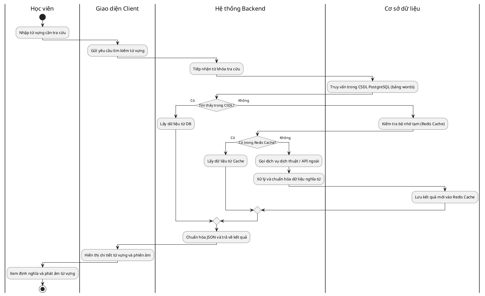

### 2.2. Mã Mermaid
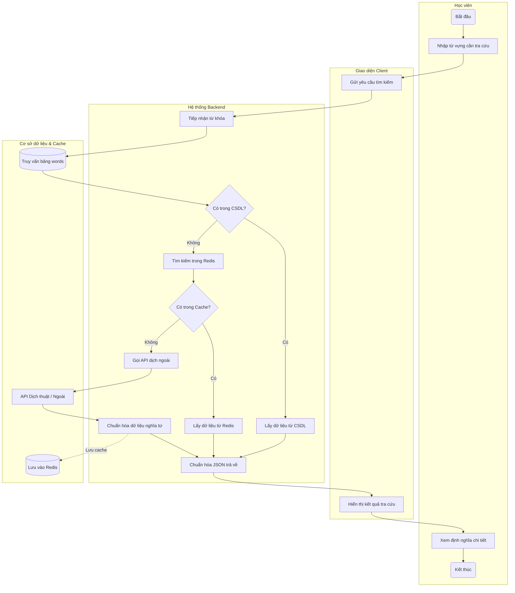

---

## 3. Biểu đồ 3: Học từ vựng Flashcard (Cập nhật trạng thái & Tiến độ)

Mô tả quy trình lật thẻ học từ, đánh dấu mức độ ghi nhớ (NEW / LEARNING / MASTERED) và cập nhật thời gian ôn tập tự động.

### 3.1. Mã PlantUML
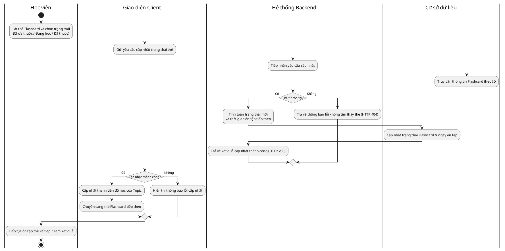

### 3.2. Mã Mermaid
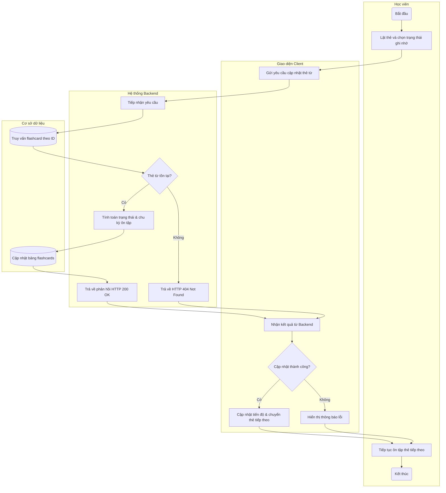

---

## 4. Biểu đồ 4: Ghi nhận chuỗi ngày học liên tục (Streak Tracking)

Mô tả thuật toán kiểm tra tính liên tục theo múi giờ client để tăng chuỗi học, duy trì hoặc reset về ngày đầu tiên.

### 4.1. Mã PlantUML
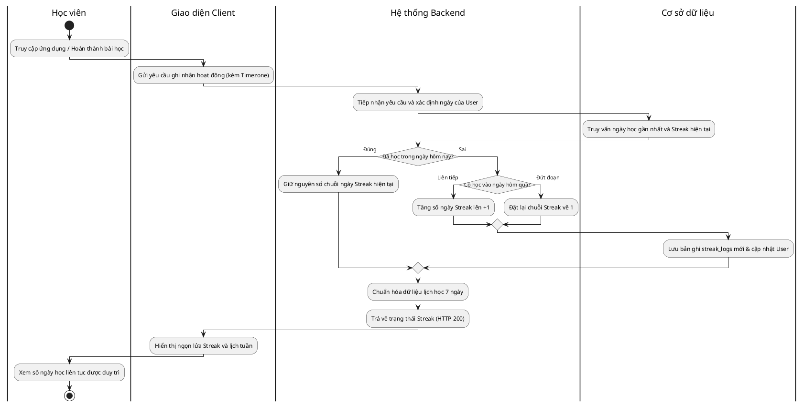

### 4.2. Mã Mermaid
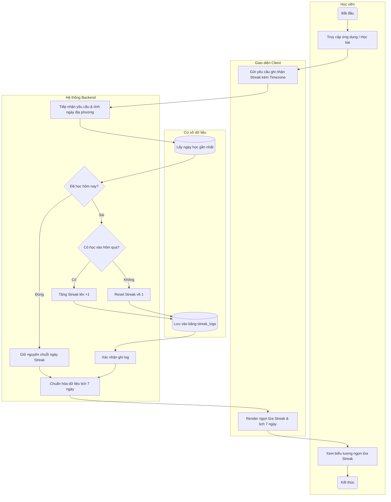

---

## 5. Biểu đồ 5: Luyện đề trắc nghiệm (Nộp bài & Chống gian lận)

Mô tả cơ chế kiểm soát phiên thi nghiêm ngặt: kiểm tra quá giờ làm bài (Timeout trên Server) và phát hiện gian lận (chuyển tab trình duyệt) trước khi chấm điểm.

### 5.1. Mã PlantUML
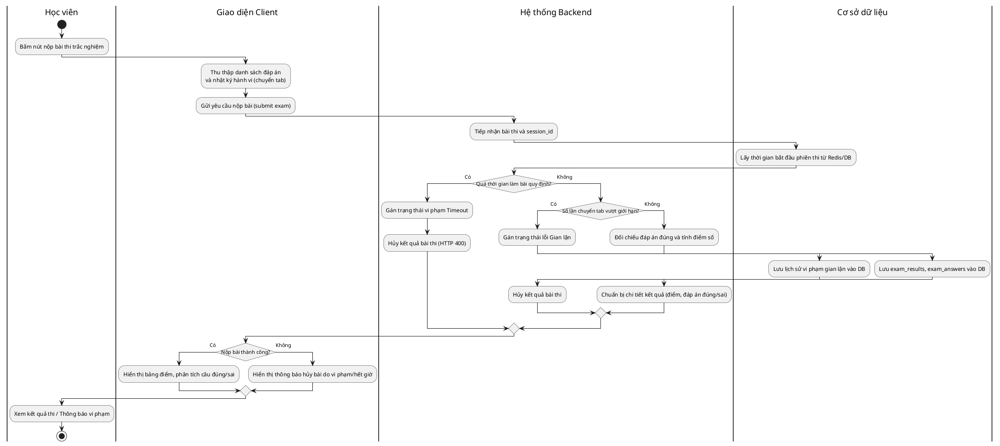

### 5.2. Mã Mermaid
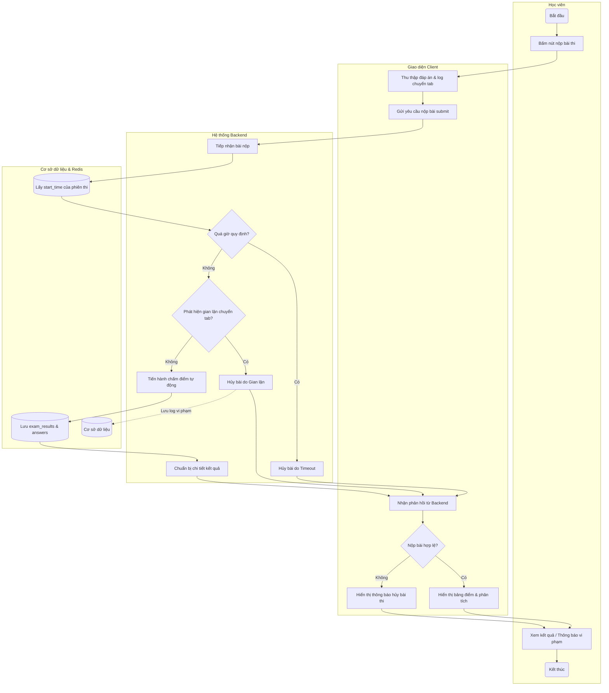

---

## 6. Biểu đồ 6: Lộ trình học tập (Tính toán Mastery & Mở khóa Chủ đề)

Mô tả thuật toán tính toán Lộ trình cá nhân hóa dựa trên Trình độ đầu vào (Tier sau Placement Test), Mục tiêu học tập, kết hợp công thức Mastery đa thành phần (Vocab 50% + Exam 25% + Lesson 25%) và ngưỡng mở khóa 60%.

### 6.1. Mã PlantUML
```plantuml
@startuml
skinparam conditionStyle insideDiamond
skinparam defaultTextAlignment center

|Học viên|
start
:Truy cập trang Lộ trình học (Learning Path);

|Giao diện Client|
:Gửi yêu cầu lấy lộ trình cá nhân hóa;

|Hệ thống Backend|
:Tiếp nhận yêu cầu từ User;

|Cơ sở dữ liệu|
:Lấy thông tin User (Tier, Mục tiêu học tập);
:Lấy danh sách các Topics và tiến độ học;

|Hệ thống Backend|
:Lọc Topics theo Tier (BEGINNER / INTERMEDIATE / ADVANCED);
:Sắp xếp thứ tự Topics ưu tiên theo mục tiêu học;

loop Duyệt qua từng Topic trong lộ trình
  :Tính % Flashcard đã thuộc (Trọng số 50%);
  :Tính % Điểm thi cao nhất (Trọng số 25%);
  :Tính % Điểm bài luyện tập (Trọng số 25%);
  :Tổng hợp Mastery = Vocab*0.5 + Exam*0.25 + Lesson*0.25;
  
  if (Là Topic đầu tiên?) then (Đúng)
    :Đánh dấu mở khóa (isUnlocked = true);
  else (Sai)
    if (Mastery của Topic trước >= 60%?) then (Đạt)
      :Đánh dấu mở khóa (isUnlocked = true);
    else (Chưa đạt)
      :Đánh dấu khóa (isUnlocked = false);
    endif
  endif
endloop

:Đóng gói danh sách Topic và trạng thái lộ trình;

|Giao diện Client|
:Render cây lộ trình học (Learning Path Map);
:Đánh dấu chặng đang học (isCurrent) và chặng bị khóa;

|Học viên|
:Xem tiến độ lộ trình và chọn bài học tiếp theo;
stop
@enduml
```

### 6.2. Mã Mermaid
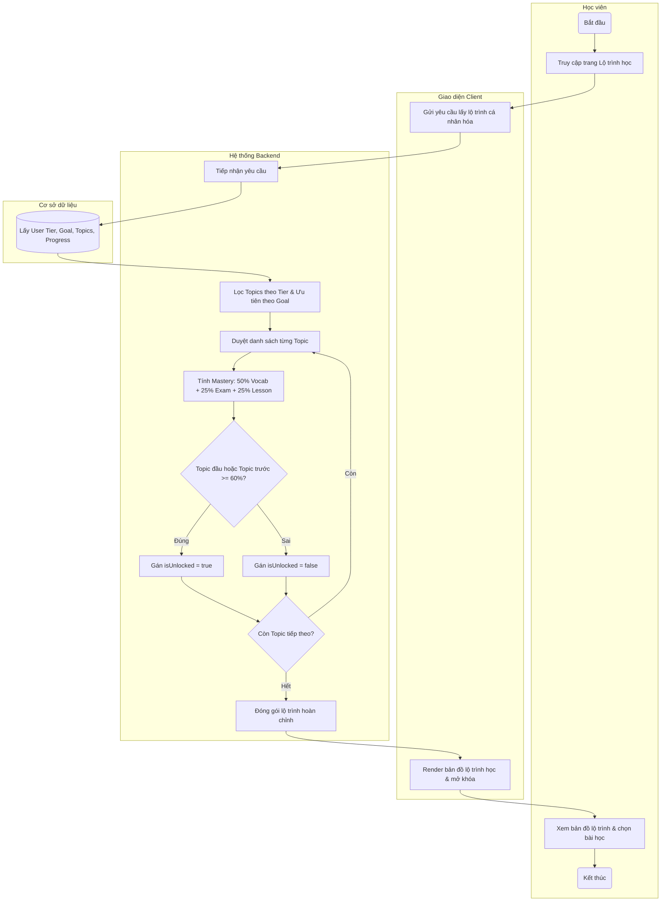

---

## 7. Bảng Tổng hợp Quyết định Logic (Decision Nodes Summary)

| Biểu đồ | Điểm rẽ nhánh (Condition) | Khi Đúng (True Path) | Khi Sai (False Path) | Ý nghĩa nghiệp vụ |
|---|---|---|---|---|
| **1. Đăng nhập** | `Có tồn tại User?` | Chuyển sang so khớp mật khẩu bằng bcrypt. | Trả về HTTP 401 ngay lập tức. | Bảo mật, ngăn chặn brute-force và giảm tải xử lý. |
| **1. Đăng nhập** | `Mật khẩu đúng?` | Tạo JWT Token, lưu Session vào Redis. | Trả về HTTP 401 (Sai mật khẩu). | Xác thực an toàn mật khẩu đã băm trong database. |
| **2. Tra từ điển** | `Tìm thấy trong CSDL?` | Lấy dữ liệu bảng `words` trả về ngay. | Chuyển sang kiểm tra bộ đệm Redis. | Tối ưu hóa truy vấn nội bộ tốc độ cao nhất. |
| **2. Tra từ điển** | `Có trong Redis Cache?` | Lấy trực tiếp từ RAM, không gọi API ngoài. | Gọi API dịch thuật và cập nhật vào Redis. | Tiết kiệm chi phí gọi dịch vụ bên ngoài và giảm độ trễ. |
| **3. Flashcard** | `Thẻ từ tồn tại?` | Cập nhật trạng thái và tính chu kỳ lặp lại. | Báo lỗi 404 Not Found. | Đảm bảo tính toàn vẹn dữ liệu người học. |
| **4. Streak** | `Đã học hôm nay?` | Giữ nguyên chuỗi ngày học hiện tại. | Kiểm tra tiếp xem có học ngày hôm qua không. | Tránh cộng dồn streak nhiều lần trong cùng một ngày. |
| **4. Streak** | `Có học vào hôm qua?` | Tăng chuỗi Streak lên +1 (Liên tục). | Reset Streak về 1 (Đứt đoạn). | Khuyến khích người học duy trì thói quen học tập đều đặn. |
| **5. Luyện thi** | `Quá thời gian quy định?` | Hủy kết quả do Timeout (Server tính). | Kiểm tra tiếp hành vi gian lận. | Chống sửa đổi đồng hồ phía client để kéo dài giờ thi. |
| **5. Luyện thi** | `Chuyển tab vượt giới hạn?`| Ghi nhận log vi phạm và hủy kết quả. | Tiến hành chấm điểm trắc nghiệm tự động. | Đảm bảo tính trung thực và công bằng cho bài thi. |
| **6. Lộ trình** | `Topic trước >= 60%?` | Mở khóa Topic tiếp theo (`isUnlocked = true`). | Khóa Topic (`isUnlocked = false`). | Đảm bảo người học nắm vững kiến thức cốt lõi trước khi học tiếp. |
