# Biểu đồ Lớp UML (Class Diagram) - Khớp 100% Cơ sở Dữ liệu & Mã nguồn ELS

Tài liệu này cung cấp thiết kế Biểu đồ lớp (**Domain / Entity Class Diagram**) chuẩn xác cho hệ thống **English Learning System (ELS)**, ánh xạ **1-1 chuẩn xác với 16 bảng trong Database PostgreSQL** và các models/services trong backend:
- **Khớp 100% CSDL:** Không tự sinh các lớp trừu tượng hay interface nhân tạo (`Student`, `Admin`, `TopicExam`, `PlacementExam`, `IScorable`). Phân quyền dựa trên RBAC (`roles`, `permissions`, `role_permissions`), loại đề thi dựa trên `exam_type` ('TOPIC', 'PLACEMENT').
- **Đường kết nối:** 100% **Orthogonal Routing** (chỉ đi ngang, dọc, bẻ góc 90°, không đi chéo, không che chữ, nhãn nằm ngay ngắn phía trên/dưới đường kẻ).
- **Màu sắc Pastel Draw.io:** Gói Package màu vàng kem `#FFF2CC`, các Lớp màu hồng cam `#F8CECC`, đường viền viền đỏ đất `#B85450`.

---

## 1. So sánh: Sơ đồ lý thuyết vs Sơ đồ thực tế Đồ án

| Tiêu chí | Sơ đồ OOP Lý thuyết (Dễ bị hội đồng bắt bẻ) | Sơ đồ Thực tế Dự án ELS (Khuyên dùng - Khớp 100% DB) |
| :--- | :--- | :--- |
| **Phân quyền người dùng** | Tự chế ra lớp con `Student`, `Admin` kế thừa `User` $\rightarrow$ *Hội đồng hỏi: "DB chỉ có 1 bảng users, bảng students và admins ở đâu?"* | Chỉ có 1 lớp **`User`** có thuộc tính `role_id` trỏ sang **`Role`** và **`Permission`** (Chuẩn mô hình bảo mật RBAC). |
| **Phân loại đề thi** | Tự chế ra `TopicExam`, `PlacementExam` kế thừa `Exam`. | Chỉ có lớp **`Exam`** với thuộc tính `exam_type` (`'TOPIC'`, `'PLACEMENT'`) đúng như cột trong CSDL. |
| **Chấm điểm & Khảo thí** | Tự vẽ interface `IScorable` dù code backend Node.js không hề khai báo interface này. | Đưa phương thức tính điểm `calculateScore()`, `isPassed()` trực tiếp vào `LessonAttempt` và `ExamResult`. |
| **Tính nhất quán** | Lệch pha giữa Báo cáo kiến trúc và Báo cáo CSDL. | **Nhất quán 100%**: Mọi lớp, mọi trường, mọi khóa ngoại (FK) đều tìm thấy chính xác trong Database và mã nguồn. |

---

## 2. Mã PlantUML (Khớp 100% CSDL & Chuẩn Manhattan Orthogonal)

> **Cách dùng trên Draw.io:**
> - Cách nhanh nhất: Kéo thả trực tiếp file [`ELS_Class_Diagram.drawio`](file:///home/vylote/Projects/Multi-platform-English-learning-system/ELS_Class_Diagram.drawio) vào trình duyệt.
> - Hoặc chọn **`+` (Insert)** $\rightarrow$ **`Advanced`** $\rightarrow$ **`PlantUML`** và dán đoạn mã dưới đây:

```plantuml
@startuml
skinparam classAttributeIconSize 0
skinparam linetype ortho
skinparam nodesep 70
skinparam ranksep 70
skinparam packageStyle rectangle
skinparam roundcorner 0
skinparam shadowing false
skinparam handwritten false

' --- BẢNG MÀU PASTEL CHUẨN DRAW.IO ---
skinparam package {
    BackgroundColor #FFF2CC
    BorderColor #D6B656
    FontColor #000000
    FontStyle bold
    FontSize 14
}

skinparam class {
    BackgroundColor #FFFFFF
    HeaderBackgroundColor #F8CECC
    BorderColor #B85450
    FontColor #000000
    FontSize 11
    ArrowColor #B85450
    ArrowThickness 1.2
}

' =======================================================
' GÓI 1: USER & AUTHENTICATION (users, roles, permissions, streak_logs)
' =======================================================
package "User & Authentication" {
    class User {
        + id : Integer
        + username : String
        + password_hash : String
        + email : String
        + role_id : Integer
        + learning_goal : String
        + created_at : DateTime
        --
        + updateProfile(email : String) : Boolean
        + verifyPassword(pass : String) : Boolean
        + getRole() : Role
    }

    class Role {
        + id : Integer
        + code : String
        + name : String
        + description : String
        + created_at : DateTime
        --
        + hasPermission(code : String) : Boolean
        + getPermissions() : List
    }

    class Permission {
        + id : Integer
        + code : String
        + name : String
        + description : String
        + created_at : DateTime
        --
        + getCode() : String
        + getName() : String
    }

    class StreakLog {
        + id : Integer
        + user_id : Integer
        + activity_date : Date
        + timezone_offset : Integer
        --
        + isConsecutive(lastDate : Date) : Boolean
        + isValidToday(clientTz : Integer) : Boolean
    }
}

' =======================================================
' GÓI 2: CURRICULUM & DICTIONARY (topics, words, idioms)
' =======================================================
package "Curriculum & Dictionary" {
    class Topic {
        + id : Integer
        + title : String
        + description : String
        + order_index : Integer = 0
        + difficulty : String
        --
        + calculateMastery(userId : Integer) : Integer
        + isUnlockedFor(user : User) : Boolean
        + getWords() : List<Word>
    }

    class Word {
        + id : Integer
        + word : String
        + pronunciation : String
        + part_of_speech : String
        + meaning_vi : String
        --
        + playPronunciation() : void
        + getDefinition() : String
    }

    class Idiom {
        + id : Integer
        + idiom : String
        + meaning : String
        + example : String
        --
        + getDisplayContent() : String
    }
}

' =======================================================
' GÓI 3: STUDY PROGRESS (flashcards, lesson_attempts)
' =======================================================
package "Study Progress" {
    class Flashcard {
        + id : Integer
        + user_id : Integer
        + word_id : Integer
        + topic_id : Integer
        + status : String = 'NEW'
        + last_reviewed : DateTime
        --
        + markStatus(newStatus : String) : void
        + isMastered() : Boolean
    }

    class LessonAttempt {
        + id : Integer
        + user_id : Integer
        + topic_id : Integer
        + quiz_score : Float
        + pronunciation_score : Float
        + completed_at : DateTime
        --
        + calculateScore() : Float
        + isPassed() : Boolean
    }
}

' =======================================================
' GÓI 4: EXAMINATION & ASSESSMENT (exams, questions, sessions, answers, results)
' =======================================================
package "Examination & Assessment" {
    class Exam {
        + id : Integer
        + topic_id : Integer
        + title : String
        + duration : Integer
        + exam_type : String
        + created_at : DateTime
        --
        + getQuestions() : List<Question>
        + validateDuration(spentTime : Integer) : Boolean
        + isPlacement() : Boolean
    }

    class Question {
        + id : Integer
        + exam_id : Integer
        + question_text : String
        + option_a : String
        + option_b : String
        + option_c : String
        + option_d : String
        + correct_option : Character
        --
        + checkAnswer(opt : Character) : Boolean
        + getClientView() : Question
    }

    class ExamSession {
        + id : Integer
        + exam_id : Integer
        + user_id : Integer
        + started_at : DateTime
        + submitted_at : DateTime
        + status : String = 'IN_PROGRESS'
        --
        + isTimeout() : Boolean
        + endSession() : ExamResult
    }

    class ExamAnswer {
        + id : Integer
        + session_id : Integer
        + question_id : Integer
        + selected_option : Character
        --
        + isCorrect() : Boolean
        + getSelected() : Character
    }

    class ExamResult {
        + id : Integer
        + user_id : Integer
        + exam_id : Integer
        + session_id : Integer
        + score : Float
        + time_spent : Integer
        + submitted_at : DateTime
        --
        + isPassed() : Boolean
        + getReviewSummary() : Object
    }
}

' =======================================================
' CÁC ĐƯỜNG KẾT NỐI ÁNH XẠ KHÓA NGOẠI (FOREIGN KEYS)
' =======================================================

' users.role_id -> roles.id
User "0..*" -left-> "1" Role : role_id >

' role_permissions -> roles & permissions
Role "1..*" o-left- "1..*" Permission : role_permissions >

' streak_logs.user_id -> users.id
User "1" *-down- "0..*" StreakLog : logs >

' topics -> words
Topic "1" o-right- "0..*" Word : categorizes >

' flashcards.word_id -> words.id
Word "1" <--down- "0..*" Flashcard : word_id <

' lesson_attempts.topic_id -> topics.id
Topic "1" <--down- "0..*" LessonAttempt : topic_id <

' lesson_attempts.user_id -> users.id
User "1" *-right- "0..*" LessonAttempt : completes >

' exams.topic_id -> topics.id
Topic "0..1" o-down- "0..*" Exam : topic_id >

' questions.exam_id -> exams.id (Composition chặt chẽ)
Exam "1" *-right- "1..*" Question : contains >

' exam_sessions.exam_id -> exams.id
ExamSession "0..*" -right-> "1" Exam : exam_id >

' exam_sessions.user_id -> users.id
ExamSession "0..*" -up-> "1" User : user_id >

' exam_answers.session_id -> exam_sessions.id (Composition)
ExamSession "1" *-down- "1..*" ExamAnswer : records >

' exam_results.session_id -> exam_sessions.id
ExamSession "1" -right-> "0..1" ExamResult : generates >

' exam_answers.question_id -> questions.id
ExamAnswer "0..*" -right-> "1" Question : question_id >
@enduml
```

---

## 3. Bảng Ánh xạ 100% giữa Database Schema và Class Diagram

| Tên bảng trong Database (PostgreSQL) | Lớp tương ứng trong Class Diagram | Khóa chính (PK) | Khóa ngoại liên kết (FK) | Giải thích nghiệp vụ |
| :--- | :--- | :--- | :--- | :--- |
| **`users`** | `User` | `id` | `role_id` $\rightarrow$ `roles(id)` | Đại diện cho tài khoản người học và quản trị viên, phân quyền qua `role_id`. |
| **`roles`** | `Role` | `id` | Không có | Danh mục vai trò hệ thống (`STUDENT`, `ADMIN`). |
| **`permissions`** | `Permission` | `id` | Không có | Danh mục các quyền chi tiết trong hệ thống. |
| **`role_permissions`** | Quan hệ N-N | `(role_id, permission_id)` | Trỏ tới `roles` và `permissions` | Bảng trung gian phân quyền giữa Vai trò và Quyền hạn. |
| **`streak_logs`** | `StreakLog` | `id` | `user_id` $\rightarrow$ `users(id)` | Nhật ký chuỗi ngày học liên tục theo từng User. |
| **`topics`** | `Topic` | `id` | Không có | Đơn vị chủ đề học tập trong Learning Path. |
| **`words`** | `Word` | `id` | `topic_id` $\rightarrow$ `topics(id)` | Kho từ vựng tiếng Anh học thuật. |
| **`idioms`** | `Idiom` | `id` | Không có | Kho thành ngữ tra cứu độc lập. |
| **`flashcards`** | `Flashcard` | `id` | `user_id`, `word_id`, `topic_id` | Tiến độ học thuộc từ vựng của từng học viên. |
| **`lesson_attempts`** | `LessonAttempt` | `id` | `user_id`, `topic_id` | Lịch sử làm bài tập luyện tập (Quiz + Phát âm) của chủ đề. |
| **`exams`** | `Exam` | `id` | `topic_id` $\rightarrow$ `topics(id)` (Nullable) | Đề thi trắc nghiệm tính giờ (`exam_type = TOPIC` hoặc `PLACEMENT`). |
| **`questions`** | `Question` | `id` | `exam_id` $\rightarrow$ `exams(id)` | Ngân hàng câu hỏi 4 lựa chọn (A, B, C, D) thuộc đề thi. |
| **`exam_sessions`** | `ExamSession` | `id` | `exam_id`, `user_id` | Phiên thi theo thời gian thực của học viên để chống gian lận. |
| **`exam_answers`** | `ExamAnswer` | `id` | `session_id`, `question_id` | Lựa chọn đáp án thí sinh đã tick cho từng câu trong phiên thi. |
| **`exam_results`** | `ExamResult` | `id` | `user_id`, `exam_id`, `session_id` | Bảng điểm chốt kết quả và thời gian làm bài sau khi nộp. |
