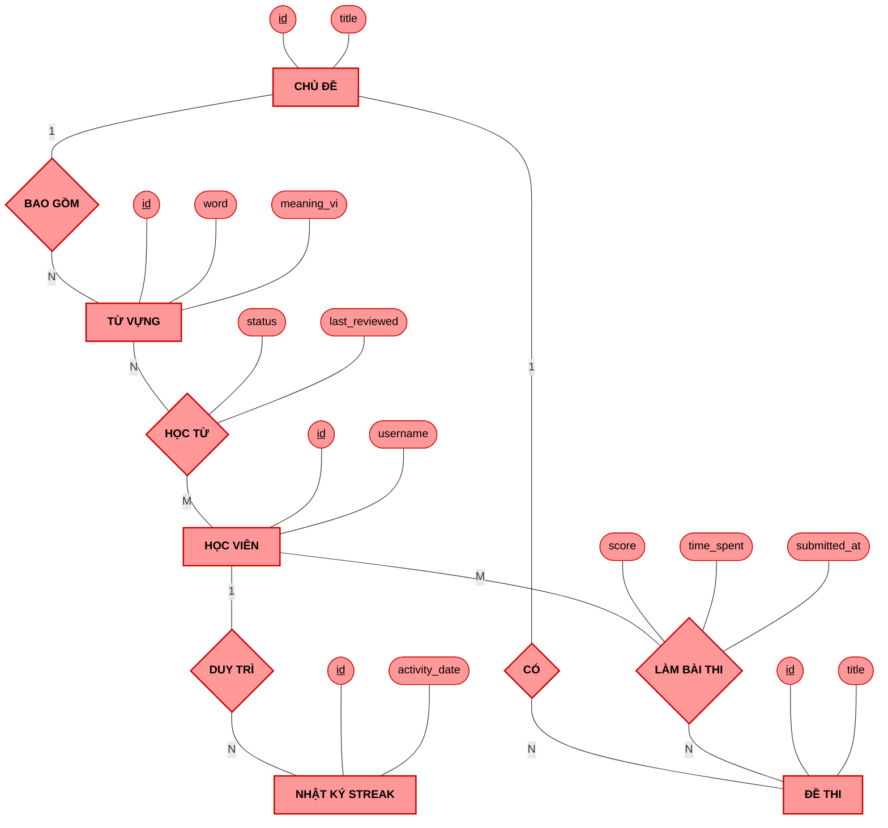

# Mô hình Thực thể - Liên kết (ER Model - Peter Chen Notation)

*(Bản cập nhật: Kiểm tra và bổ sung đầy đủ các thuộc tính cấu thành từ Mối quan hệ Nhiều - Nhiều (M-N). Các thuộc tính như `status`, `score`, `time_spent`, `submitted_at` được móc nối chuẩn xác trực tiếp vào khối Hình thoi).*

---

## 1. Mã PlantUML (Giao diện Peter Chen Cổ điển - Bố cục Chống đè nét)

```plantuml
@startuml
skinparam linetype polyline
skinparam nodesep 70
skinparam ranksep 70
skinparam defaultTextAlignment center

' --- CẤU HÌNH MÀU SẮC CHUẨN (Tone Đỏ Hồng - Salmon) ---
skinparam rectangle {
    BackgroundColor #FF9999
    BorderColor #CC0000
    shadowing false
}
skinparam diamond {
    BackgroundColor #FF9999
    BorderColor #CC0000
    shadowing false
}
skinparam usecase {
    BackgroundColor #FF9999
    BorderColor #CC0000
    shadowing false
}

' ==========================================
' 1. KHAI BÁO THỰC THỂ (ENTITIES)
' ==========================================
rectangle "CHỦ ĐỀ" as E_Topic
rectangle "TỪ VỰNG" as E_Word
rectangle "HỌC VIÊN" as E_User
rectangle "NHẬT KÝ STREAK" as E_Streak
rectangle "ĐỀ THI" as E_Exam

' ==========================================
' 2. BỐ CỤC MỐI QUAN HỆ (RELATIONSHIPS)
' ==========================================
' Trục ngang chính (Nằm phía trên): Chủ đề -> Từ vựng -> Học viên -> Streak
diamond "BAO GỒM" as Rel_Topic_Word
E_Topic -right- "1" Rel_Topic_Word
Rel_Topic_Word -right- "N" E_Word

diamond "HỌC TỪ" as Rel_Learn
E_Word -right- "N" Rel_Learn
Rel_Learn -right- "M" E_User

diamond "DUY TRÌ" as Rel_User_Streak
E_User -right- "1" Rel_User_Streak
Rel_User_Streak -right- "N" E_Streak

' Trục dọc & chéo (Nằm phía dưới): Chủ đề -> Đề thi <- Học viên
diamond "CÓ" as Rel_Topic_Exam
E_Topic -down- "1" Rel_Topic_Exam
Rel_Topic_Exam -down- "N" E_Exam

diamond "LÀM BÀI THI" as Rel_TakeExam
E_User -down- "M" Rel_TakeExam
Rel_TakeExam -left- "N" E_Exam

' ==========================================
' 3. TỎA NHÁNH THUỘC TÍNH (ATTRIBUTES)
' ==========================================

' Chủ đề (Rảnh Top, Left)
usecase "<u>id</u>" as T_id
usecase "title" as T_title
E_Topic -up- T_id
E_Topic -left- T_title

' Từ vựng (Rảnh Top, Bottom)
usecase "<u>id</u>" as W_id
usecase "word" as W_word
usecase "meaning_vi" as W_mean
E_Word -up- W_id
E_Word -up- W_word
E_Word -down- W_mean

' Học viên (Rảnh Top)
usecase "<u>id</u>" as U_id
usecase "username" as U_name
usecase "email" as U_email
usecase "tier" as U_tier
E_User -up- U_id
E_User -up- U_name
E_User -up- U_email
E_User -up- U_tier

' Streak (Rảnh Top, Right, Bottom)
usecase "<u>id</u>" as S_id
usecase "activity_date" as S_date
E_Streak -up- S_id
E_Streak -right- S_date

' Đề thi (Rảnh Bottom, Right)
usecase "<u>id</u>" as Ex_id
usecase "title" as Ex_title
usecase "duration" as Ex_dur
E_Exam -down- Ex_id
E_Exam -down- Ex_title
E_Exam -right- Ex_dur

' ==========================================
' 4. THUỘC TÍNH CỦA MỐI QUAN HỆ (M-N)
' ==========================================

' Quan hệ M-N: Học từ (Flashcard) (Rảnh Top, Bottom)
usecase "status" as L_status
usecase "last_reviewed" as L_rev
Rel_Learn -up- L_status
Rel_Learn -down- L_rev

' Quan hệ M-N: Làm bài (Exam Results) (Rảnh Bottom, Right)
usecase "score" as TE_score
usecase "time_spent" as TE_time
usecase "submitted_at" as TE_submit
Rel_TakeExam -right- TE_score
Rel_TakeExam -right- TE_time
Rel_TakeExam -down- TE_submit

@enduml
```

---

## 2. Mã Mermaid (Peter Chen Chuẩn Hình Thoi)



---

## 3. Phần Thuyết minh Ký hiệu Mô hình Khái niệm (Đưa vào báo cáo đồ án)

| Ký hiệu Peter Chen | Tên gọi (Tiếng Việt) | Ý nghĩa và Ứng dụng trong hệ thống ELS |
| :---: | :--- | :--- |
| 🟦 Hình chữ nhật | **Thực thể (Entity)** | Biểu diễn một đối tượng vật lý hoặc khái niệm tồn tại độc lập trong thế giới thực mà hệ thống cần lưu trữ thông tin. <br>**Ví dụ:** `[HỌC VIÊN]`, `[TỪ VỰNG]`, `[CHỦ ĐỀ]`. |
| 🟡 Hình bầu dục | **Thuộc tính (Attribute)** | Biểu diễn một đặc điểm, tính chất của Thực thể hoặc Mối quan hệ. Được nối trực tiếp bằng đường nét liền. <br>**Ví dụ:** `email`, `username`, `title`. |
| 🟡 Chữ gạch chân | **Thuộc tính Khóa (Key Attribute)** | Là một thuộc tính đặc biệt (nằm trong hình bầu dục) có giá trị duy nhất, dùng để phân biệt các bản ghi khác nhau. <br>**Ví dụ:** Khóa `<u>id</u>` của Học viên. |
| 🔶 Hình thoi | **Mối quan hệ (Relationship)** | Biểu diễn sự tương tác, gắn kết giữa 2 hoặc nhiều Thực thể. Trên các đường nối sẽ ghi rõ Bội số quan hệ (1, M, N). <br>**Ví dụ:** Học viên `{DUY TRÌ}` Nhật ký Streak. |
| 🔶 Kèm Bầu dục | **Thuộc tính của Mối quan hệ** | Là những thông tin **sinh ra từ sự tương tác** giữa 2 hay nhiều thực thể, không thuộc về một thực thể đơn lẻ nào. Thường gặp nhất ở quan hệ **Nhiều - Nhiều (M - N)**.<br>**Ví dụ 1:** Học viên `{HỌC TỪ}` Từ vựng (M-N), sinh ra thuộc tính `status` và `last_reviewed`.<br>**Ví dụ 2:** Học viên `{LÀM BÀI THI}` Đề thi (M-N), sinh ra thuộc tính `score`, `time_spent`, `submitted_at`. |
