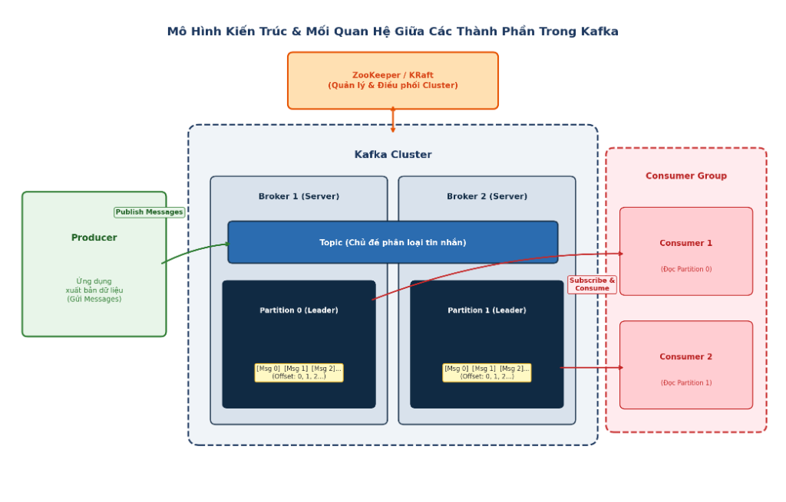

# Kiến trúc Apache Kafka trong Hệ thống AnhLingo

Tài liệu này mô tả tổng quan mô hình xử lý sự kiện bất đồng bộ bằng Apache Kafka trong hệ thống AnhLingo.

---

## 1. Mô Hình Nguyên Lý Cốt Lõi



Mô hình trên thể hiện 4 thành phần nền tảng:
- **KRaft**: Quản lý và điều phối toàn bộ cụm Kafka (Cluster).
- **Producer**: Ứng dụng xuất bản (gửi) thông điệp vào các Chủ đề (Topic).
- **Topic & Partition**: Một Chủ đề chia thành nhiều Phân vùng (Partition) đặt trên các Broker khác nhau.
- **Record & Offset**: Mỗi Phân vùng chứa chuỗi các bản ghi `[Msg 0], [Msg 1], [Msg 2]...` được đánh số thứ tự liên tục `(Offset: 0, 1, 2...)`.
- **Consumer Group**: Nhóm nhận thông điệp để xử lý độc lập, mỗi Consumer trong nhóm chia nhau đọc từng Partition.

---

## 2. Sơ Đồ Kiến Trúc Hệ Thống Dạng Văn Bản

Sơ đồ thể hiện rõ cấu trúc phân tầng: **Nguồn gửi -> Chủ đề (Topic) -> Phân vùng (Partition) chứa Bản ghi (Record & Offset) trên từng Broker -> Nhóm nhận (Consumer Group)**:

```text
========================================================================================================================
                                       KIEN TRUC VA LUONG DU LIEU KAFKA - ANHLINGO
========================================================================================================================

[ NGUON GUI (PRODUCERS) ]               [ CUM KAFKA: TOPIC -> PARTITION -> RECORDS ]                  [ NHOM NHAN (CONSUMERS) ]
------------------------------------------------------------------------------------------------------------------------

                           +========================== TOPIC: exam.submissions ==========================+
                           |                                                                            |
Dich vu Bai thi ---------> | Partition 0 (Broker 1) : [Msg 0] [Msg 1] [Msg 2]... (Offset: 0, 1, 2...)    | ---> Nhom 1: Cham thi & AI
                           | Partition 1 (Broker 2) : [Msg 0] [Msg 1] [Msg 2]... (Offset: 0, 1, 2...)    |
                           | Partition 2 (Broker 3) : [Msg 0] [Msg 1] [Msg 2]... (Offset: 0, 1, 2...)    |
                           +============================================================================+

                           +=================== TOPIC: learning.activity.completed =====================+
Dich vu Bai thi ---------> |                                                                            | ---> Nhom 2: Chuoi ngay hoc
                           | Partition 0 (Broker 1) : [Msg 0] [Msg 1] [Msg 2]... (Offset: 0, 1, 2...)    |
Dich vu Bai hoc ---------> | Partition 1 (Broker 2) : [Msg 0] [Msg 1] [Msg 2]... (Offset: 0, 1, 2...)    | ---> Nhom 3: Cong EXP & BXH
                           | Partition 2 (Broker 3) : [Msg 0] [Msg 1] [Msg 2]... (Offset: 0, 1, 2...)    |
                           +============================================================================+

                           +====================== TOPIC: vocab.learning.events ========================+
                           |                                                                            | ---> Nhom 4: Flashcard tu sai
Dich vu Bai hoc ---------> | Partition 0 (Broker 1) : [Msg 0] [Msg 1] [Msg 2]... (Offset: 0, 1, 2...)    |
                           | Partition 1 (Broker 2) : [Msg 0] [Msg 1] [Msg 2]... (Offset: 0, 1, 2...)    | ---> Nhom 5: Thong ke tu yeu
                           | Partition 2 (Broker 3) : [Msg 0] [Msg 1] [Msg 2]... (Offset: 0, 1, 2...)    |
                           +============================================================================+
========================================================================================================================
```

---

## 3. Bảng Ánh Xạ Nghiệp Vụ Cụ Thể

| Nguồn gửi (Producer) | Chủ đề (Topic) | Nhóm nhận (Consumer Group) | Mục đích nghiệp vụ |
| :--- | :--- | :--- | :--- |
| Dịch vụ bài thi | `exam.submissions` | `exam-ai-evaluation-group` | Chấm điểm bài thi và gọi AI (Groq) phân tích kết quả học tập. |
| Dịch vụ bài thi & bài học | `learning.activity.completed` | `streak-tracker-group` | Cập nhật số ngày học liên tiếp của người dùng. |
| Dịch vụ bài thi & bài học | `learning.activity.completed` | `gamification-exp-group` | Cộng điểm kinh nghiệm (EXP) và xếp hạng học viên theo tuần. |
| Dịch vụ bài học & phát âm | `vocab.learning.events` | `smart-flashcard-enqueue-group` | Tự động đưa các từ phát âm yếu vào danh mục thẻ nhớ ôn tập ngắt quãng. |
| Dịch vụ bài học & phát âm | `vocab.learning.events` | `vocab-analytics-group` | Thống kê danh sách từ vựng người dùng thường xuyên mắc lỗi. |

---

## 4. Lệnh Khởi Chạy

Khởi động hạ tầng 3 Broker:
```bash
docker compose -f docker-compose.kafka.yml up -d
```

Khởi chạy tiến trình xử lý nền 5 nhóm nhận:
```bash
cd backend
npm run kafka:worker
```

Bảng quản trị trực quan: `http://localhost:8085`
