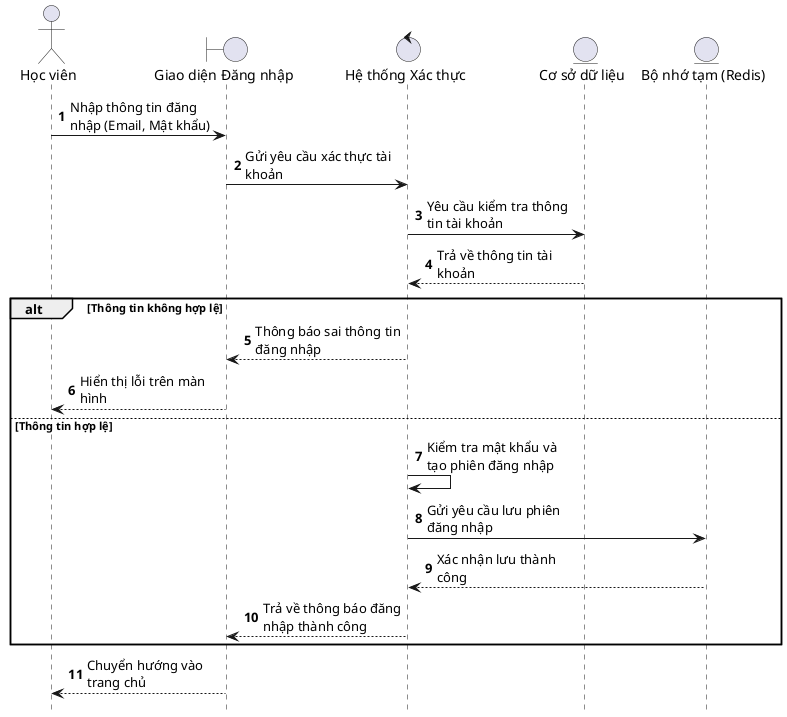
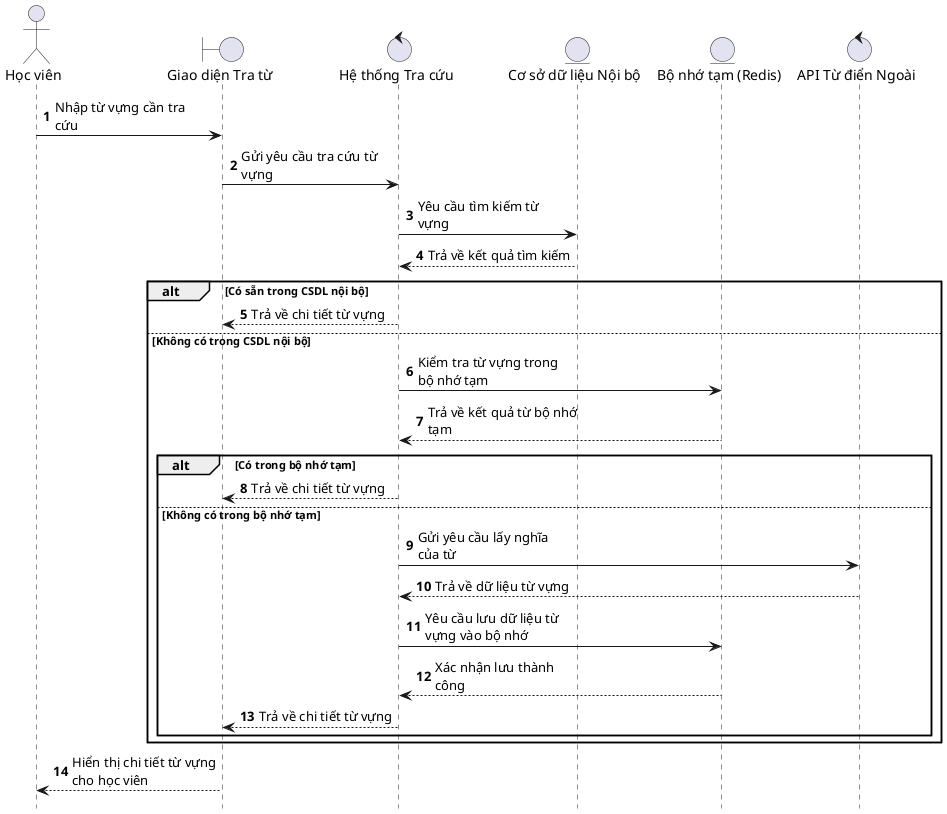
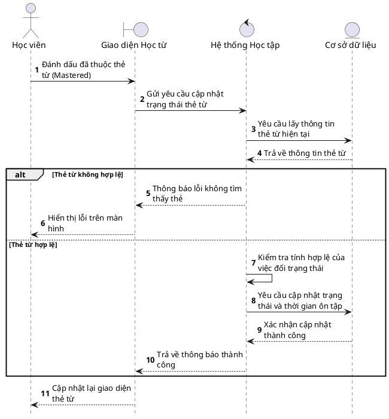
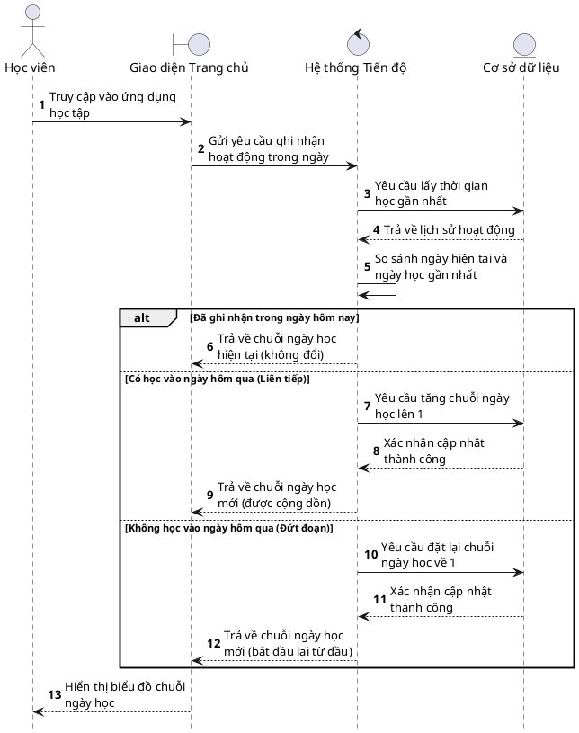
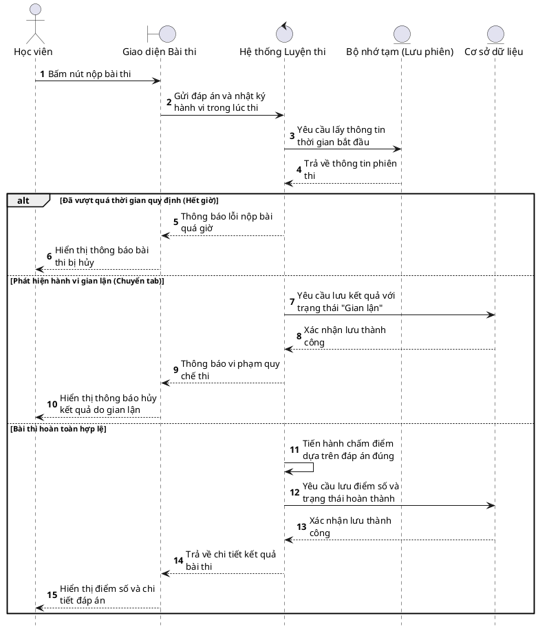
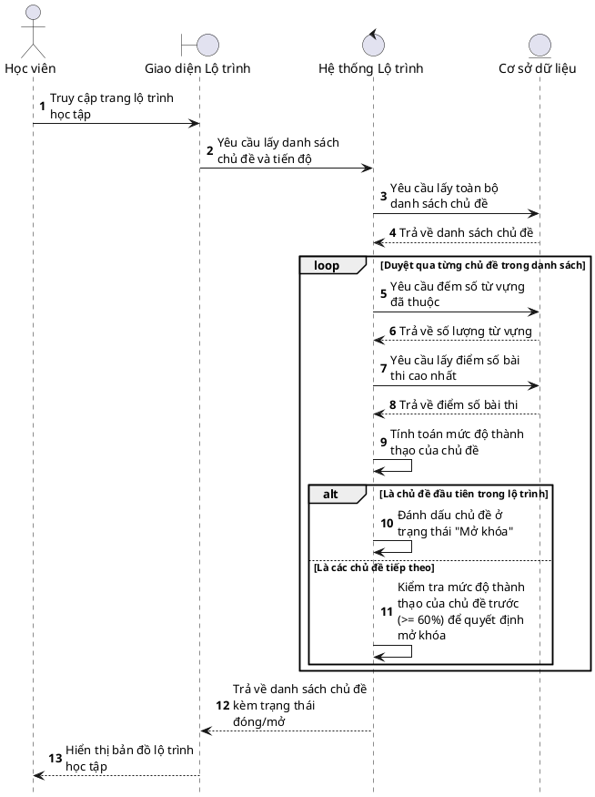

# Danh sách Biểu đồ Tuần tự (Sequence Diagrams)

Toàn bộ các biểu đồ dưới đây đã được chuẩn hóa theo ký hiệu UML tiêu chuẩn bao gồm:
- **Actor** (Hình người): Người dùng
- **Boundary** (Hình chữ T tròn): Giao diện người dùng
- **Control** (Hình mũi tên tròn): Hệ thống xử lý logic
- **Entity** (Hình gạch ngang tròn): Cơ sở dữ liệu / Bộ nhớ tạm

*(Đã gỡ bỏ toàn bộ các khung vuông bọc ngoài / khung dọc (activation boxes) và khung dưới cùng (footbox) để biểu đồ trông gọn gàng, giống hình mẫu nhất).*

---

## 1. Luồng Xác thực người dùng (Đăng nhập)

---

## 2. Luồng Tra cứu từ điển (Có lưu tạm thời)

---

## 3. Luồng Học từ vựng (Cập nhật tiến độ Flashcard)

---

## 4. Luồng Chuỗi ngày học (Ghi nhận hoạt động - Streak)

---

## 5. Luồng Luyện đề trắc nghiệm (Nộp bài & Chống gian lận)

---

## 6. Luồng Lộ trình học tập (Tính toán & Mở khóa Chủ đề)

